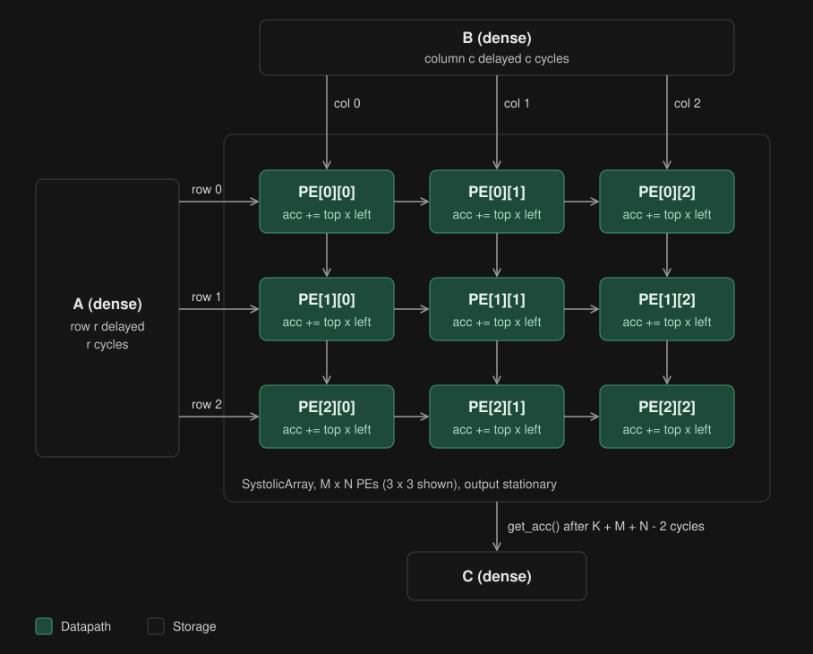
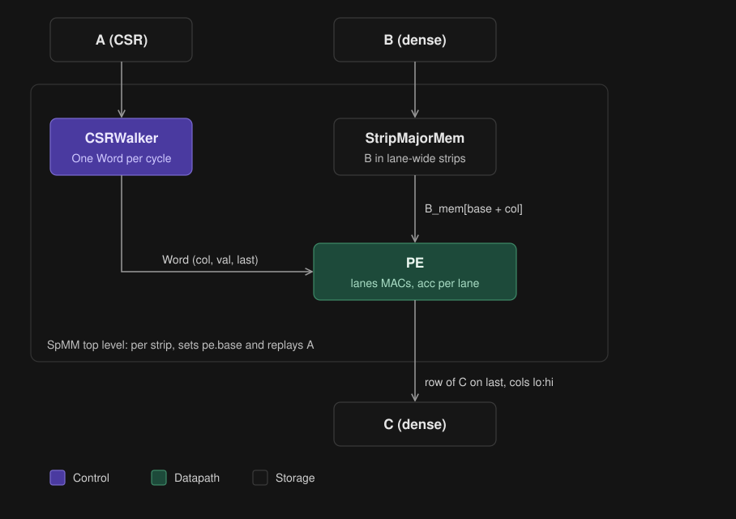
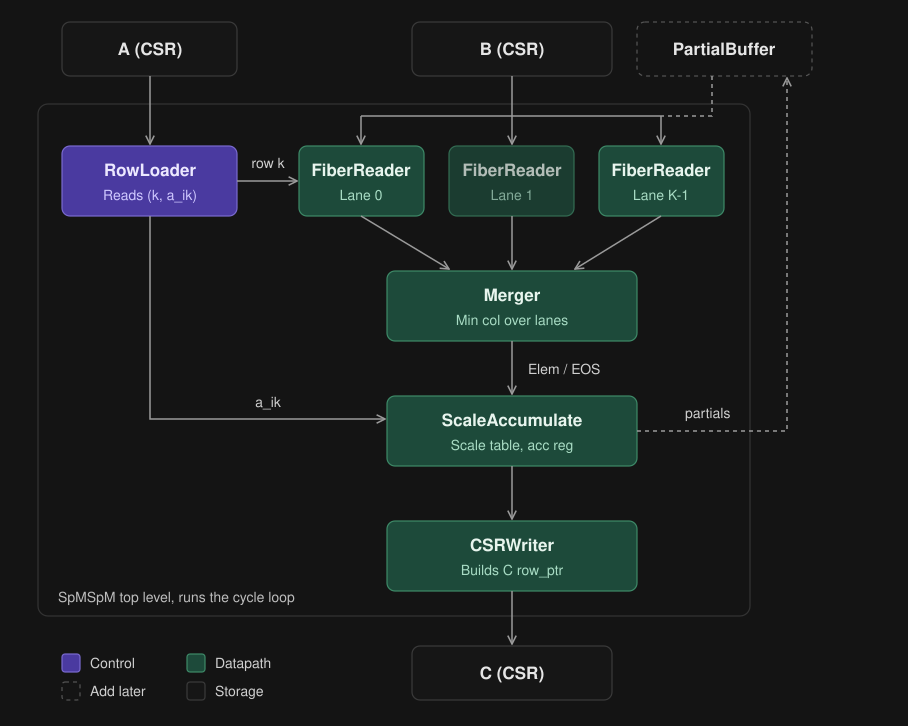

# Matrix multiplication hardware models

Cycle-level Python models of three matrix multiplication accelerators, from dense to fully sparse.
Each model steps one clock cycle at a time and can print a per-cycle trace.

| Directory | Model | Operation |
|---|---|---|
| `src/DenseMatDenseMat/` | `SystolicArray.py` | Dense x dense on an output-stationary systolic array of multiply-accumulate PEs |
| `src/SparseMatDenseMat/` | `SpMM.py` | Sparse A (CSR) x dense B: a CSR walker streams A into a lane-wide PE, with B stored in column strips |
| `src/SparseMatSparseMat/` | `SpMSpM.py` | Sparse A (CSR) x sparse B (CSR), Gustavson row-by-row: row loader -> fiber readers -> merger -> scale/accumulate -> CSR writer |

## Systolic array



A enters from the left and B from the top, each row/column delayed by its index so matching values meet in the right PE.
Every PE does `acc += top x left` and passes its inputs right and down. C stays in the accumulators (output stationary).

## SpMM



B is stored in lane-wide column strips. For each strip, `CSRWalker` replays A one nonzero per cycle and the PE
multiplies it by the matching strip row of B, accumulating one lane per output column. On the last nonzero of a row
the PE emits that row of C and clears its accumulators.

## SpMSpM pipeline



For each row i of A, every nonzero `a_ik` is assigned to a lane, which reads row k of B.

1. `RowLoader` hands out row i of A as `(col, val)` pairs, at most `num_lanes` of them.
2. `FiberReader` (one per lane) streams its row of B one element at a time.
3. `Merger` picks the smallest column across all lane heads, ties going to the lowest lane.
4. `ScaleAccumulate` multiplies each element by its lane's `a_ik` and sums runs of the same column.
5. `CSRWriter` builds C in CSR form.

It takes one cycle per partial product plus one end-of-stream cycle per row of A.

## Requirements

Python 3.10+, `numpy` and `pytest`:

```
pip install numpy pytest
```

## Running the tests

Run every test:

```
python3 -m pytest tests
```

Or run a test file directly:

```
python3 tests/test_SpMSpM.py
python3 tests/test_SpMM.py
python3 tests/test_systolic_array.py
```

Tests take a `verbose=False` argument. Pass `verbose=True` in a file's `__main__` block to print the per-cycle trace.
`test_spmspm` is a randomised test over 50 seeds under pytest. Change the seed in `__main__` to trace a different case.
